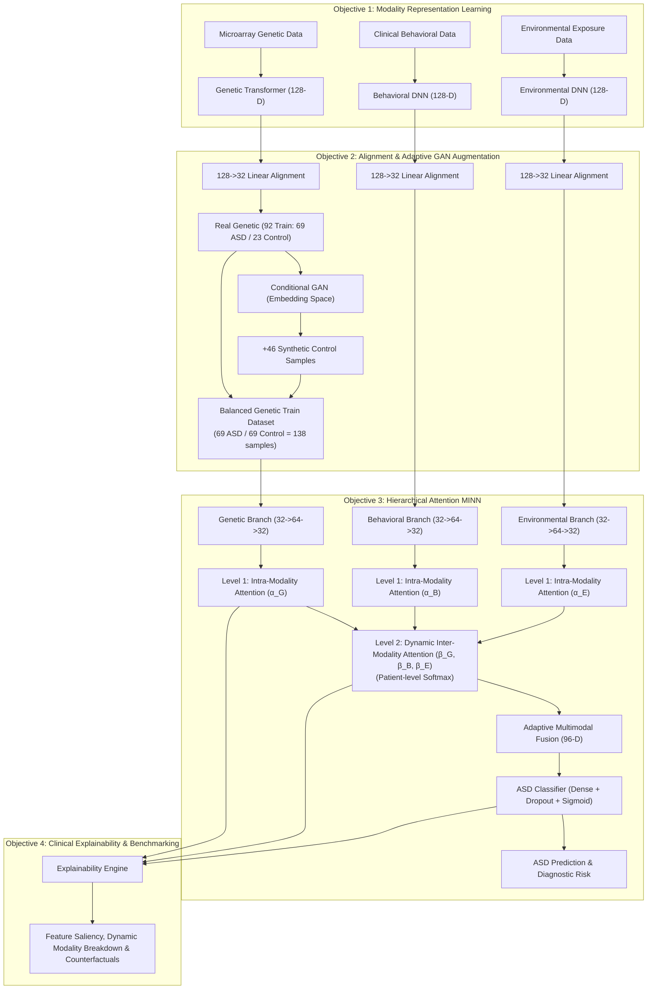

# Objective 3: Hierarchical Attention-Based Multi-Input Neural Network (MINN)

## Overview
This package implements **Objective 3** of the research roadmap:
> *"To develop a hierarchical attention-based multimodal feature fusion strategy integrated with a Multi-Input Neural Network for learning complementary genetic, environmental, and behavioral representations for ASD screening."*

---

## Data Flow & Objective Handoff Diagram



---

## Directory Structure
```
08_hierarchical_minn/
├── data/                                 # Aligned 32-D and balanced handoff datasets
│   ├── genetic_32d_train_gan_balanced.csv
│   ├── genetic_32d_test_unseen.csv
│   ├── behavioral_32d_all.csv
│   └── environmental_32d_all.csv
├── models/
│   ├── hierarchical_minn.py              # PyTorch model definition
│   └── minn_best.pt                      # Saved best model checkpoint
├── results/
│   ├── minn_config.json                  # Model hyperparameter configuration
│   ├── training_history.csv              # Per-epoch training/val losses and AUCs
│   ├── model_benchmarking_comparison.csv # Comparison vs Unimodal & Multimodal Baselines
│   └── patient_level_attention_weights.csv
├── figures/
│   ├── training_curves.png
│   ├── roc_curve_benchmarking.png
│   ├── minn_confusion_matrix.png
│   ├── inter_modality_attention_distribution.png
│   └── intra_modality_feature_saliency.png
├── reports/
│   ├── objective3_minn_evaluation_report.txt
│   └── attention_mechanism_validation.txt
├── create_handoff_dataset.py             # Generates Objective 2 -> 3 handoff data
├── data_loader.py                        # Dataset & DataLoader utility
├── train_minn.py                         # Training pipeline with early stopping
├── evaluate_and_benchmark.py             # Evaluation and baseline benchmarking
└── inspect_attention.py                  # Dynamic attention validation
```

---

## How to Reproduce Each Stage

### 1. Generate the Objective 2 Balanced Handoff Dataset
```bash
python 08_hierarchical_minn/create_handoff_dataset.py
```
Projects GAN-augmented synthetic samples to 32-D space and outputs `genetic_32d_train_gan_balanced.csv`.

### 2. Train the Hierarchical Attention MINN
```bash
python 08_hierarchical_minn/train_minn.py
```
Trains the model with AdamW, Cosine Annealing, and saves `minn_best.pt` along with loss curves.

### 3. Evaluate and Benchmark Against Baselines
```bash
python 08_hierarchical_minn/evaluate_and_benchmark.py
```
Evaluates on the held-out unseen test set, generates confusion matrices and ROC curves, and compares against:
- Unimodal Genetic MLP
- Unimodal Behavioral MLP
- Unimodal Environmental MLP
- Multimodal Early Fusion MLP (No Attention)
- Calibrated Evidence Probability Fusion (M3.2 static weights)

### 4. Inspect Learned Attention Distributions
```bash
python 08_hierarchical_minn/inspect_attention.py
```
Extracts feature saliency ($\boldsymbol{\alpha}$) and patient-specific dynamic modality weights ($\beta$) to confirm dynamic variation.
