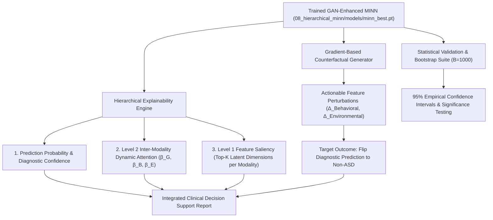

# Objective 4: Clinical Explainability & Statistical Benchmarking

## Overview
This package implements **Objective 4** of the research roadmap:
> *"To develop an explainable and clinically interpretable GAN-enhanced Multi-Input Neural Network by integrating hierarchical attention-based explainability with counterfactual explanation generation and validate its effectiveness against existing unimodal and multimodal ASD screening models."*

---

## Architecture & Explainability Flow



---

## Directory Structure
```
09_explainability_benchmarking/
├── models/ -> points to 08_hierarchical_minn/models/
├── results/
│   ├── patient_clinical_explanations.json
│   └── statistical_confidence_intervals.csv
├── figures/
│   ├── clinical_counterfactual_case_study.png
│   └── patient_attention_profiles.png
├── reports/
│   ├── objective4_explainability_report.txt
│   └── statistical_validation_report.txt
├── explainability_engine.py          # Feature & Modality Attention extractor
├── counterfactual_generator.py       # Gradient-based counterfactual optimizer
├── generate_clinical_explanations.py # Demo case studies & visual plots
├── statistical_validation.py         # Bootstrap 95% Confidence Intervals
└── README.md
```

---

## How to Run & Reproduce

### 1. Generate Clinical Explanations & Counterfactual Case Studies
```bash
python 09_explainability_benchmarking/generate_clinical_explanations.py
```
Outputs `patient_clinical_explanations.json` and figures:
- `clinical_counterfactual_case_study.png`
- `patient_attention_profiles.png`

### 2. Run Statistical Bootstrap Validation
```bash
python 09_explainability_benchmarking/statistical_validation.py
```
Computes empirical 95% Confidence Intervals over 1,000 bootstrap resamples for Accuracy, F1, and ROC-AUC.
