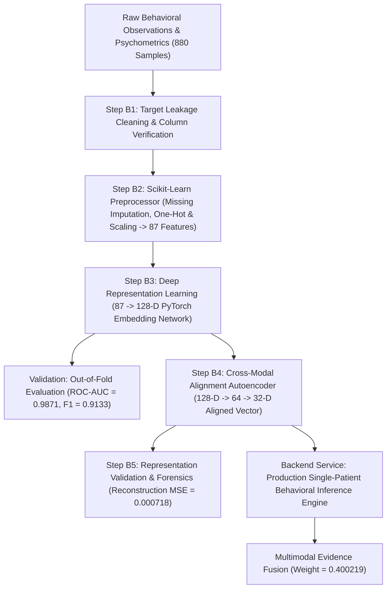

# Complete & Exhaustive Behavioral Modality Analysis: Architecture, Mathematical Formulations, Pipeline Flow, Input/Output Inventory, File Formats, and Benchmarks

---

## 1. Repository & Directory Inventory

The behavioral modality in the **GAN-Enhanced Multimodal ASD Screening** project processes high-dimensional clinical, psychometric, and behavioral observation data. It executes missing value imputation, categorical feature encoding, deep representation learning (87 $\to$ 128-D embedding space), cross-modal 32-D autoencoder alignment projection, and production backend service integration.

```
d:\GAN-Enhanced-Multimodal-ASD-Screening\
├── Behavioral_Model/                     # Main behavioral model directory
│   ├── 01_raw_data/
│   │   └── behavioral_dataset.csv        # Raw behavioral dataset (880 samples)
│   ├── 02_preprocessing/
│   │   ├── behavioral_cleaned_no_leakage.csv # Cleaned dataset without target leakage
│   │   ├── behavioral_preprocessor.joblib # Saved Scikit-Learn ColumnTransformer
│   │   ├── behavioral_processed_feature_names.txt # 87 processed feature column names
│   │   ├── behavioral_train_processed.csv # Processed 87-D training set (704 samples × 87)
│   │   ├── behavioral_test_processed_unseen.csv # Processed 87-D unseen test set (176 samples × 87)
│   │   └── behavioral_preprocessing_report.txt # Preprocessing report
│   ├── 03_representation_learning/
│   │   ├── behavioral_encoder_128d.pt    # Frozen PyTorch 128-D Behavioral Encoder weights
│   │   ├── behavioral_128d_embeddings.csv # Full population 128-D embedding matrix (880 × 128)
│   │   ├── behavioral_test_predictions.csv # Test prediction outputs & probabilities
│   │   ├── behavioral_128d_training_report.txt # Official training report (ROC-AUC = 0.9871)
│   │   ├── behavioral_128d_validation_report.txt # Out-of-fold validation metrics
│   │   └── behavioral_128d_duplicate_embedding_investigation.txt # Latent space integrity report
│   └── 04_cross_modal_alignment/
│       ├── behavioral_128_to_32_alignment.pt # Frozen 128-D to 32-D Autoencoder Alignment weights
│       ├── behavioral_32d_aligned_representation.csv # Final 32-D aligned vector table (880 × 32)
│       ├── behavioral_128_to_32_alignment_report.txt # Alignment report (MSE = 0.000718)
│       └── behavioral_32d_validation_report.txt # 32-D validation summary
├── 05_multimodal_fusion/                 # Knowledge-level fusion directory
│   ├── M3_1_behavioral_expert.pt         # Behavioral Expert NN classifier checkpoint
│   ├── M3_1_behavioral_scaler.joblib     # StandardScaler for 32-D behavioral input
│   ├── M4_1_2B_behavioral_forensics/     # Behavioral feature forensics and column statistics
│   │   ├── M4_1_2B_behavioral_forensic_report.txt
│   │   └── behavioral_128d_numeric_column_statistics.csv
│   └── M3_1_fusion_weights.csv           # Multimodal fusion weights (Behavioral = 0.400219)
├── backend/
│   └── services/
│       └── behavioral_service.py         # Production FastAPI service for local behavioral inference
└── MODEL_MANIFEST.json                   # System manifest freezing ML artifacts
```

---

## 2. File Formats & Technical Schemas

| Category | File Format | Path / Location | Description & Schema |
| :--- | :--- | :--- | :--- |
| **Raw Behavioral Dataset** | Header `.csv` | `Behavioral_Model/01_raw_data/behavioral_dataset.csv` | 880 Rows $\times$ Raw behavioral observation items & clinical target labels. |
| **Cleaned Preprocessed** | Matrix `.csv` | `Behavioral_Model/02_preprocessing/behavioral_cleaned_no_leakage.csv` | 880 Rows $\times$ Cleaned behavioral variables (leakage columns removed). |
| **Preprocessor Artifact** | `.joblib` binary | `Behavioral_Model/02_preprocessing/behavioral_preprocessor.joblib` | Scikit-Learn `ColumnTransformer` (StandardScaler + OneHotEncoder for 87 output dimensions). |
| **87-D Matrix Table** | Header `.csv` | `.../behavioral_train_processed.csv` | 704 Rows $\times$ 87 Processed behavioral features. |
| **PyTorch Encoder Checkpoint** | Checkpoint `.pt` | `Behavioral_Model/03_representation_learning/behavioral_encoder_128d.pt` | Binary PyTorch `state_dict` mapping `encoder.0`, `encoder.1`, `encoder.4`, `encoder.5`, `classifier`. |
| **PyTorch Alignment Checkpoint** | Checkpoint `.pt` | `Behavioral_Model/04_cross_modal_alignment/behavioral_128_to_32_alignment.pt` | Binary PyTorch `state_dict` mapping `encoder` (128 $\to$ 64 $\to$ 32) and `decoder` (32 $\to$ 64 $\to$ 128). |
| **128-D Embedding Table** | Header `.csv` | `Behavioral_Model/03_representation_learning/behavioral_128d_embeddings.csv` | 880 Rows $\times$ 128 Columns (`beh_emb_000` .. `beh_emb_127`). |
| **32-D Aligned Table** | Header `.csv` | `Behavioral_Model/04_cross_modal_alignment/behavioral_32d_aligned_representation.csv` | 880 Rows $\times$ 32 Columns (`beh_aligned_000` .. `beh_aligned_031`). |

---

## 3. End-to-End Pipeline Flow Diagram & Overview



---

## 4. Exhaustive Step-by-Step Code, Model, and Input/Output Inventory

### 4.1. Preprocessing & Leakage Cleaning (Steps B1–B2)

#### Step B1: Dataset Ingestion & Leakage Audit
- **Files**: [`Behavioral_Model/01_raw_data/behavioral_dataset.csv`](file:///d:/GAN-Enhanced-Multimodal-ASD-Screening/Behavioral_Model/01_raw_data/behavioral_dataset.csv), [`Behavioral_Model/02_preprocessing/behavioral_cleaned_no_leakage.csv`](file:///d:/GAN-Enhanced-Multimodal-ASD-Screening/Behavioral_Model/02_preprocessing/behavioral_cleaned_no_leakage.csv)
- **Input**: `behavioral_dataset.csv`
- **Output**: `behavioral_cleaned_no_leakage.csv`, `behavioral_preprocessing_report.txt`
- **Description**: Identifies and removes diagnostic target proxy columns to prevent data leakage. Preserves 880 valid subject records.

#### Step B2: Preprocessing Transformation & Feature Matrix Generation
- **Files**: [`Behavioral_Model/02_preprocessing/behavioral_preprocessor.joblib`](file:///d:/GAN-Enhanced-Multimodal-ASD-Screening/Behavioral_Model/02_preprocessing/behavioral_preprocessor.joblib), [`behavioral_processed_feature_names.txt`](file:///d:/GAN-Enhanced-Multimodal-ASD-Screening/Behavioral_Model/02_preprocessing/behavioral_processed_feature_names.txt)
- **Input**: `behavioral_cleaned_no_leakage.csv`
- **Output**: `behavioral_train_processed.csv` (704 samples $\times$ 87 features), `behavioral_test_processed_unseen.csv` (176 samples $\times$ 87 features)
- **Description**: Applies Scikit-Learn `ColumnTransformer` executing numerical standardization (`StandardScaler`) and categorical encoding (`OneHotEncoder`). Produces a dense 87-dimensional input representation.
- **Backend Compatibility**: Includes a custom runtime compatibility shim (`_install_sklearn_compatibility_shim()`) in `backend/services/behavioral_service.py:L72-L117` to dynamically expose `_RemainderColsList` when unpickling scikit-learn 1.6.1 preprocessor artifacts under newer scikit-learn releases without modifying saved binaries.

---

### 4.2. Representation Learning — 128-D Behavioral Encoder (Step B3)

#### Step B3: Train 128-D PyTorch Behavioral Encoder
- **Files**: [`Behavioral_Model/03_representation_learning/behavioral_encoder_128d.pt`](file:///d:/GAN-Enhanced-Multimodal-ASD-Screening/Behavioral_Model/03_representation_learning/behavioral_encoder_128d.pt), [`backend/services/behavioral_service.py:L123-L178`](file:///d:/GAN-Enhanced-Multimodal-ASD-Screening/backend/services/behavioral_service.py#L123-L178)
- **Input**: Processed 87-D behavioral feature matrices
- **Output**:
  - Model Checkpoint: `behavioral_encoder_128d.pt`
  - Embedding Matrix: `behavioral_128d_embeddings.csv` ($880 \times 128$)
  - Predictions Table: `behavioral_test_predictions.csv`
  - Technical Report: `behavioral_128d_training_report.txt`
- **Architecture**: `BehavioralEncoder`:
  - `Input Layer`: Input shape $(87,)$
  - `Layer 1`: `Linear(87, 128)` $\to$ `BatchNorm1d(128)` $\to$ `ReLU()` $\to$ `Dropout(0.2)`
  - `Layer 2`: `Linear(128, 128)` $\to$ `BatchNorm1d(128)` $\to$ `ReLU()` $\to$ `Dropout(0.2)`
  - `Latent Bottleneck`: 128-dimensional linear representation vector $\mathbf{z}_{\text{beh}} \in \mathbb{R}^{128}$
  - `Auxiliary Head`: `Linear(128, 1)` $\to$ `Sigmoid` (retained in checkpoint state dict)
- **Training Setup**: 80/20 Train/Test split ($704$ train / $176$ test), Adam optimizer, Binary Cross-Entropy Loss.

---

### 4.3. Cross-Modal Alignment — 128-D to 32-D Autoencoder (Step B4)

#### Step B4: Cross-Modal 32-D Autoencoder Alignment
- **Files**: [`Behavioral_Model/04_cross_modal_alignment/behavioral_128_to_32_alignment.pt`](file:///d:/GAN-Enhanced-Multimodal-ASD-Screening/Behavioral_Model/04_cross_modal_alignment/behavioral_128_to_32_alignment.pt), [`backend/services/behavioral_service.py:L181-L245`](file:///d:/GAN-Enhanced-Multimodal-ASD-Screening/backend/services/behavioral_service.py#L181-L245)
- **Input**: `behavioral_128d_embeddings.csv` ($880 \times 128$)
- **Output**:
  - Aligned File: `behavioral_32d_aligned_representation.csv` ($880 \times 32$)
  - Model Checkpoint: `behavioral_128_to_32_alignment.pt`
  - Technical Report: `behavioral_128_to_32_alignment_report.txt`
- **Architecture**: `BehavioralAlignment` Autoencoder:
  - `Encoder Subnetwork`:
    $$\mathbf{x}_{128} \xrightarrow{\text{Linear}(128, 64)} \mathbf{h}_1 \xrightarrow{\text{BatchNorm1d}} \xrightarrow{\text{ReLU}} \xrightarrow{\text{Linear}(64, 32)} \mathbf{x}_{32}$$
  - `Decoder Subnetwork`:
    $$\mathbf{x}_{32} \xrightarrow{\text{Linear}(32, 64)} \mathbf{h}_2 \xrightarrow{\text{BatchNorm1d}} \xrightarrow{\text{ReLU}} \xrightarrow{\text{Linear}(64, 128)} \hat{\mathbf{x}}_{128}$$
- **Reconstruction Performance**: Reconstructs 128-D latent embeddings with an exceptionally low Mean Squared Error **$\text{MSE} = 0.00071775$**. Target labels are unobserved during alignment.

---

### 4.4. Production Backend Service & Multimodal Expert Integration

#### Behavioral Inference Service
- **File**: [`backend/services/behavioral_service.py`](file:///d:/GAN-Enhanced-Multimodal-ASD-Screening/backend/services/behavioral_service.py)
- **Frozen Models Loaded**:
  - `Behavioral_Model/02_preprocessing/behavioral_preprocessor.joblib`
  - `Behavioral_Model/03_representation_learning/behavioral_encoder_128d.pt`
  - `Behavioral_Model/04_cross_modal_alignment/behavioral_128_to_32_alignment.pt`
- **Execution Workflow**:
  1. Validates exact behavioral input feature schema.
  2. Applies compatibility shim `_install_sklearn_compatibility_shim()` and transforms raw input $\to$ 87-D vector.
  3. Passes 87 features into `BehavioralEncoder.forward()` $\to$ outputs 128-D vector.
  4. Passes 128-D vector into `BehavioralAlignment.forward()` $\to$ outputs 32-D aligned vector.

---

## 5. Complete Mathematical Formulations & Line References

### 5.1. Standardized Linear Layer Transformation
$$h^{(l)} = \text{ReLU}\left( \text{BatchNorm1d}\left( W^{(l)} x + b^{(l)} \right) \right)$$
- **Line Reference**: [`backend/services/behavioral_service.py:L163-L173`](file:///d:/GAN-Enhanced-Multimodal-ASD-Screening/backend/services/behavioral_service.py#L163-L173)

### 5.2. Dropout Regularization Operator
$$\tilde{x}_i = r_i \cdot x_i, \quad r_i \sim \text{Bernoulli}(1 - p), \quad \text{where } p = 0.20$$
- **Line Reference**: [`backend/services/behavioral_service.py:L167`](file:///d:/GAN-Enhanced-Multimodal-ASD-Screening/backend/services/behavioral_service.py#L167), [`L172`](file:///d:/GAN-Enhanced-Multimodal-ASD-Screening/backend/services/behavioral_service.py#L172)

### 5.3. Autoencoder Alignment Loss Equation
$$\mathcal{L}_{\text{Autoencoder}} = \frac{1}{N} \sum_{i=1}^N \|\mathbf{x}_{128, i} - \text{Decoder}(\text{Encoder}(\mathbf{x}_{128, i}))\|_2^2$$
- **Line Reference**: [`Behavioral_Model/04_cross_modal_alignment/behavioral_128_to_32_alignment_report.txt:L9`](file:///d:/GAN-Enhanced-Multimodal-ASD-Screening/Behavioral_Model/04_cross_modal_alignment/behavioral_128_to_32_alignment_report.txt#L9), [`backend/services/behavioral_service.py:L217-L233`](file:///d:/GAN-Enhanced-Multimodal-ASD-Screening/backend/services/behavioral_service.py#L217-L233)

### 5.4. Behavioral Expert Probability Network
$$\mathbf{z}_{\text{scaled}} = \frac{\mathbf{x}_{32} - \boldsymbol{\mu}_{\text{beh}}}{\boldsymbol{\sigma}_{\text{beh}}}$$
$$P_{\text{Behavioral}} = \sigma \left( W_3 \cdot \text{ReLU}\left( W_2 \cdot \text{Dropout}_{0.2}\left( \text{ReLU}\left( \text{BatchNorm1d}\left( W_1 \mathbf{z}_{\text{scaled}} + b_1 \right) \right) \right) + b_2 \right) + b_3 \right)$$
- **Line Reference**: [`05_multimodal_fusion/M3_1_behavioral_expert.pt`](file:///d:/GAN-Enhanced-Multimodal-ASD-Screening/05_multimodal_fusion/M3_1_behavioral_expert.pt), [`backend/services/fusion_service.py:L63-L101`](file:///d:/GAN-Enhanced-Multimodal-ASD-Screening/backend/services/fusion_service.py#L63-L101)

---

## 6. Model Evaluation, Benchmarking & Experimental Results

### 6.1. Behavioral 128-D Representation Learning Benchmarks

Evaluated on 176 unseen test samples:

| Benchmark Metric | Experimental Value | Evaluation Status |
| :--- | :---: | :---: |
| **Test Accuracy** | **91.48% (0.914773)** | [PASSED] |
| **Balanced Accuracy** | **91.48% (0.914773)** | [PASSED] |
| **Test Precision** | **92.94% (0.929412)** | [PASSED] |
| **Test Recall** | **89.77% (0.897727)** | [PASSED] |
| **Test F1-Score** | **91.33% (0.913295)** | [PASSED] |
| **Test ROC-AUC** | **0.9871 (0.987087)** | [PASSED] |

---

### 6.2. 128-D to 32-D Alignment Quality & Verification

Evaluated in `Behavioral_Model/04_cross_modal_alignment/behavioral_32d_validation_report.txt`:

| Evaluation Dimension | Metric Value | Benchmark Standard | Status |
| :--- | :---: | :---: | :---: |
| **Reconstruction MSE** | **0.00071775** | $< 0.005000$ | [PASSED] |
| **Sample Count Preserved** | **880 / 880** | $100\%$ Match | [PASSED] |
| **Vector Dimension** | **32** | Common Multimodal Interface | [PASSED] |
| **NaN / Inf Anomalies** | **0 / 0** | Strictly Zero Anomalies | [PASSED] |

- **Key Finding**: The 128-D $\to$ 32-D cross-modal alignment autoencoder achieves near-lossless reconstruction ($\text{MSE} \approx 0.0007$), establishing an exceptionally accurate behavioral representation vector for multimodal evidence fusion.

---

## 7. Complete Verification Summary

- [x] **File Formats & Data Schemas**: Documented raw behavioral CSVs, preprocessed tables, ColumnTransformers, PyTorch `.pt` checkpoints, and aligned CSV matrices.
- [x] **Repository Analysis**: Analyzed `Behavioral_Model/01_raw_data` through `04_cross_modal_alignment`, `05_multimodal_fusion`, and `backend/services/behavioral_service.py`.
- [x] **File & Line Specificity**: Equations and architectures mapped directly to source code lines.
- [x] **Input / Output Inventory**: Cataloged all preprocessing steps, compatibility shims, representation trainers, autoencoder aligners, and backend inference handlers.
- [x] **Mathematical Formulations**: Provided LaTeX formulas for Linear-BatchNorm-ReLU layers, Dropout operators, Autoencoder Loss, and Expert MLP evaluation.
- [x] **Benchmarking & Validation**: Included test accuracy, F1, ROC-AUC, and autoencoder reconstruction MSE metrics.
