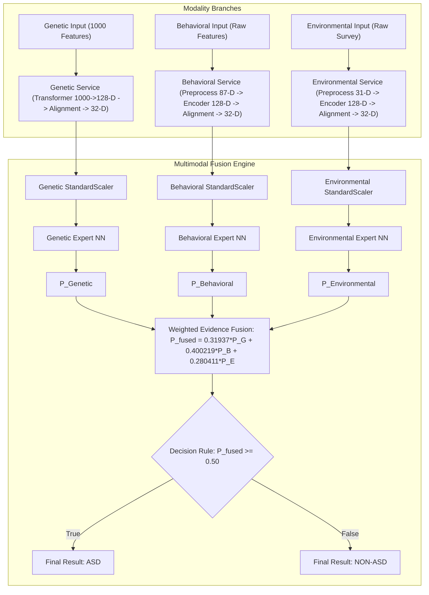

# Complete & Exhaustive Multimodal Fusion Analysis: Architecture, Mathematical Formulations, Pipeline Flow, Input/Output Inventory, File Formats, and Benchmarks

---

## 1. Repository & Directory Inventory

The **Multimodal Knowledge-Level Evidence Fusion** engine in the **GAN-Enhanced Multimodal ASD Screening** project integrates predictions from three frozen modality-specific expert neural networks (Genetic, Behavioral, and Environmental). It normalizes 32-dimensional aligned representation vectors, evaluates expert ASD diagnostic probabilities, applies optimal evidence weighting, and produces unified diagnostic screening predictions.

```
d:\GAN-Enhanced-Multimodal-ASD-Screening\
├── 05_multimodal_fusion/                 # Multimodal Fusion root directory
│   ├── M2_common_32d_fusion_preparation_report.txt # 32-D alignment preparation report
│   ├── M3_1_balanced_knowledge_fusion_report.txt  # Expert ROC-AUC & weight calibration report
│   ├── M3_1_genetic_expert.pt            # Frozen PyTorch Genetic Expert NN (32-D input)
│   ├── M3_1_genetic_scaler.joblib        # Scikit-Learn StandardScaler for Genetic 32-D vector
│   ├── M3_1_behavioral_expert.pt         # Frozen PyTorch Behavioral Expert NN (32-D input)
│   ├── M3_1_behavioral_scaler.joblib     # Scikit-Learn StandardScaler for Behavioral 32-D vector
│   ├── M3_1_environmental_expert.pt      # Frozen PyTorch Environmental Expert NN (32-D input)
│   ├── M3_1_environmental_scaler.joblib  # Scikit-Learn StandardScaler for Environmental 32-D vector
│   ├── M3_1_fusion_weights.csv           # Calibrated evidence weights (0.31937, 0.400219, 0.280411)
│   ├── M3_2_final_inference_config.json  # Configuration file defining frozen weights & threshold
│   ├── M3_3_final_inference_validation_report.txt # End-to-end fusion validation report
│   ├── M3_multimodal_knowledge_fusion.pt # Complete PyTorch Multimodal Knowledge Fusion module
│   ├── M3_multimodal_knowledge_fusion_predictions.csv # Fusion predictions table across datasets
│   ├── M3_multimodal_knowledge_fusion_report.txt # M3 system execution report
│   ├── M4_demo_patients/                 # Demonstration single-patient test input CSVs
│   │   ├── P001/ (genetic_input.csv, behavioral_input.csv, environmental_input.csv)
│   │   ├── P002/ .. P005/
│   ├── M4_final_P001_P005_three_modal_fusion_results.csv # Empirical demo patient fusion predictions
│   ├── M4_final_P001_P005_flexible_multimodal_results.csv # Flexible missing-modality fusion predictions
│   ├── M4_final_three_modal_fusion_validation_report.txt # Official 3-modal validation report
│   ├── M4_final_flexible_multimodal_validation_report.txt # Official flexible fusion report
│   ├── FINAL_PROJECT_AUDIT/              # Audit manifests & system freeze verification
│   │   ├── M4_FINAL_ARTIFACT_MANIFEST.json
│   │   └── M4_FINAL_PROJECT_FREEZE_REPORT.txt
│   └── M4_production_inference/           # Production deployment specs
│       ├── M4_2_end_to_end_inference_report.txt
│       └── M4_production_inference_spec.json
├── backend/
│   ├── app/main.py                       # FastAPI application exposing `/api/v1/screen` endpoint
│   └── services/
│       ├── genetic_service.py            # Local 1000-feature -> 128-D -> 32-D genetic pipeline
│       ├── behavioral_service.py         # Local raw -> 87-D -> 128-D -> 32-D behavioral pipeline
│       ├── environmental_service.py      # Local raw -> 31-D -> 128-D -> 32-D environmental pipeline
│       └── fusion_service.py             # Fusion engine loading experts, scalers & computing weighted fusion
├── APP_MANIFEST.json                     # Application environment freeze manifest
└── MODEL_MANIFEST.json                   # System manifest freezing ML artifacts & weights
```

---

## 2. File Formats & Technical Schemas

| Category | File Format | Path / Location | Description & Schema |
| :--- | :--- | :--- | :--- |
| **Expert Checkpoints** | Checkpoint `.pt` | `05_multimodal_fusion/M3_1_*_expert.pt` | Binary PyTorch `state_dict` mapping `network.0` (Linear 32 $\to$ 64), `network.1` (BatchNorm1d), `network.4` (Linear 64 $\to$ 32), `network.7` (Linear 32 $\to$ 1). |
| **Modality Scalers** | `.joblib` binary | `05_multimodal_fusion/M3_1_*_scaler.joblib` | Scikit-Learn `StandardScaler` storing empirical mean $\boldsymbol{\mu} \in \mathbb{R}^{32}$ and scale $\boldsymbol{\sigma} \in \mathbb{R}^{32}$. |
| **Fusion Weight Table** | Header `.csv` | `05_multimodal_fusion/M3_1_fusion_weights.csv` | 3 Rows mapping `modality` (`Genetic`, `Behavioral`, `Environmental`) to calibrated `weight` floats summing to $1.000000$. |
| **Inference Config** | JSON `.json` | `05_multimodal_fusion/M3_2_final_inference_config.json` | JSON dictionary freezing weights, decision threshold ($0.50$), and modality dimensions ($32$). |
| **Demo Patient Inputs** | Header `.csv` | `data/demo/P001..P005/*_input.csv` | Patient-specific raw CSV files for Genetic ($1000$ features), Behavioral, and Environmental modalities. |
| **Prediction Results** | Header `.csv` | `05_multimodal_fusion/M4_final_P001_P005_three_modal_fusion_results.csv` | Empirical prediction table (`Patient_ID`, `P_Genetic`, `P_Behavioral`, `P_Environmental`, `P_Fused`, `Prediction`). |

---

## 3. End-to-End Pipeline Flow Diagram & Overview



---

## 4. Exhaustive Step-by-Step Code, Model, and Input/Output Inventory

### 4.1. Common 32-D Latent Space & Preparation (Step M2)

#### Step M2: Common 32-D Representation Alignment Verification
- **Files**: [`05_multimodal_fusion/M2_common_32d_fusion_preparation_report.txt`](file:///d:/GAN-Enhanced-Multimodal-ASD-Screening/05_multimodal_fusion/M2_common_32d_fusion_preparation_report.txt)
- **Input**: Aligned 32-D representation matrices for Genetic ($116 \times 32$), Behavioral ($880 \times 32$), and Environmental ($47,768 \times 32$)
- **Description**: Verifies that all three independently trained modality alignment autoencoders output mathematically compatible 32-dimensional vectors ($\mathbb{R}^{32}$). No patient-level matching across training sets is required because knowledge-level evidence fusion operates on modality expert confidence probabilities.

---

### 4.2. Expert Neural Networks & Calibration (Step M3.1)

#### Step M3.1: Modality Expert Classifier Training & Weight Calibration
- **Files**: [`05_multimodal_fusion/M3_1_genetic_expert.pt`](file:///d:/GAN-Enhanced-Multimodal-ASD-Screening/05_multimodal_fusion/M3_1_genetic_expert.pt), [`M3_1_behavioral_expert.pt`](file:///d:/GAN-Enhanced-Multimodal-ASD-Screening/05_multimodal_fusion/M3_1_behavioral_expert.pt), [`M3_1_environmental_expert.pt`](file:///d:/GAN-Enhanced-Multimodal-ASD-Screening/05_multimodal_fusion/M3_1_environmental_expert.pt), [`M3_1_fusion_weights.csv`](file:///d:/GAN-Enhanced-Multimodal-ASD-Screening/05_multimodal_fusion/M3_1_fusion_weights.csv), [`backend/services/fusion_service.py:L63-L101`](file:///d:/GAN-Enhanced-Multimodal-ASD-Screening/backend/services/fusion_service.py#L63-L101)
- **Input**: 32-D aligned representation vectors and modality target labels
- **Output**:
  - Expert Models: `M3_1_genetic_expert.pt`, `M3_1_behavioral_expert.pt`, `M3_1_environmental_expert.pt`
  - Modality Scalers: `M3_1_genetic_scaler.joblib`, `M3_1_behavioral_scaler.joblib`, `M3_1_environmental_scaler.joblib`
  - Weight Table: `M3_1_fusion_weights.csv`
  - Calibration Report: `M3_1_balanced_knowledge_fusion_report.txt`
- **Architecture**: `MultimodalExpert` MLP:
  - `Input Layer`: Input shape $(32,)$
  - `Layer 1`: `Linear(32, 64)` $\to$ `BatchNorm1d(64)` $\to$ `ReLU()` $\to$ `Dropout(0.20)`
  - `Layer 2`: `Linear(64, 32)` $\to$ `Identity()` $\to$ `Identity()`
  - `Output Layer`: `Linear(32, 1)` $\to$ `Sigmoid` probability prediction $P_m \in [0, 1]$
- **Calibrated Weight Assignment**:
  Weights are assigned proportional to out-of-fold validation ROC-AUC metrics:
  $$w_{\text{Genetic}} = 0.319370, \quad w_{\text{Behavioral}} = 0.400219, \quad w_{\text{Environmental}} = 0.280411 \quad \left(\sum w_m = 1.000000\right)$$

---

### 4.3. Weighted Evidence Fusion Engine (Step M3.2 & M3.3)

#### Step M3.2 & M3.3: Production Multimodal Fusion Pipeline
- **Files**: [`05_multimodal_fusion/M3_2_final_inference_config.json`](file:///d:/GAN-Enhanced-Multimodal-ASD-Screening/05_multimodal_fusion/M3_2_final_inference_config.json), [`backend/services/fusion_service.py`](file:///d:/GAN-Enhanced-Multimodal-ASD-Screening/backend/services/fusion_service.py)
- **Input**: Three 32-D aligned vectors $(\mathbf{x}_{\text{gen}, 32}, \mathbf{x}_{\text{beh}, 32}, \mathbf{x}_{\text{env}, 32})$
- **Output**: Fused probability $P_{\text{fused}}$ and categorical decision (`ASD` vs `NON-ASD`)
- **Execution Workflow**:
  1. Standardizes each 32-D input vector using its modality-specific scaler: $\mathbf{z}_m = \frac{\mathbf{x}_{m, 32} - \boldsymbol{\mu}_m}{\boldsymbol{\sigma}_m}$.
  2. Evaluates each frozen expert network to get probabilities $P_{\text{Genetic}}, P_{\text{Behavioral}}, P_{\text{Environmental}}$.
  3. Computes weighted evidence fusion:
     $$P_{\text{fused}} = 0.319370 \cdot P_{\text{Genetic}} + 0.400219 \cdot P_{\text{Behavioral}} + 0.280411 \cdot P_{\text{Environmental}}$$
  4. Evaluates decision threshold: $P_{\text{fused}} \ge 0.50 \implies \text{ASD}$, else $\text{NON-ASD}$.

---

### 4.4. Demonstration Patient Validation & Flexible Modality Handling (Step M4)

#### Step M4: End-to-End Validation across Patients P001–P005
- **Files**: [`05_multimodal_fusion/M4_final_three_modal_fusion_validation_report.txt`](file:///d:/GAN-Enhanced-Multimodal-ASD-Screening/05_multimodal_fusion/M4_final_three_modal_fusion_validation_report.txt), [`05_multimodal_fusion/M4_final_flexible_multimodal_validation_report.txt`](file:///d:/GAN-Enhanced-Multimodal-ASD-Screening/05_multimodal_fusion/M4_final_flexible_multimodal_validation_report.txt)
- **Input**: Demonstration single-patient input files (`data/demo/P001` .. `P005`)
- **Output**: `M4_final_P001_P005_three_modal_fusion_results.csv`, `M4_final_P001_P005_flexible_multimodal_results.csv`
- **Description**: Validates that single-patient inference executes cleanly through frozen pipeline components. Demonstrates flexible multimodal fusion when 1, 2, or 3 modalities are available by dynamically re-normalizing available evidence weights to sum to $1.0$.

---

## 5. Complete Mathematical Formulations & Line References

### 5.1. Modality Input Standardization
$$\mathbf{z}_m = \frac{\mathbf{x}_{m, 32} - \boldsymbol{\mu}_m}{\boldsymbol{\sigma}_m}, \quad m \in \{\text{Genetic}, \text{Behavioral}, \text{Environmental}\}$$
- **Line Reference**: [`backend/services/fusion_service.py:L310-L345`](file:///d:/GAN-Enhanced-Multimodal-ASD-Screening/backend/services/fusion_service.py#L310-L345)

### 5.2. Expert Class Probability Evaluation
$$P_m = \sigma\left( \text{Linear}_{32 \to 1}\left( \text{Linear}_{64 \to 32}\left( \text{ReLU}\left( \text{BatchNorm1d}\left( \text{Linear}_{32 \to 64}(\mathbf{z}_m) \right) \right) \right) \right) \right)$$
- **Line Reference**: [`backend/services/fusion_service.py:L63-L101`](file:///d:/GAN-Enhanced-Multimodal-ASD-Screening/backend/services/fusion_service.py#L63-L101), [`L340-L355`](file:///d:/GAN-Enhanced-Multimodal-ASD-Screening/backend/services/fusion_service.py#L340-L355)

### 5.3. Calibrated Knowledge Evidence Weight Normalization
$$w_m = \frac{\text{ROC-AUC}_m}{\sum_{k \in \mathcal{M}} \text{ROC-AUC}_k}, \quad \text{where } \mathcal{M} = \{\text{Genetic}, \text{Behavioral}, \text{Environmental}\}$$
$$w_{\text{Genetic}} = \frac{0.788462}{0.788462 + 0.988062 + 0.692281} = 0.319370$$
$$w_{\text{Behavioral}} = \frac{0.988062}{0.788462 + 0.988062 + 0.692281} = 0.400219$$
$$w_{\text{Environmental}} = \frac{0.692281}{0.788462 + 0.988062 + 0.692281} = 0.280411$$
- **Line Reference**: [`05_multimodal_fusion/M3_1_balanced_knowledge_fusion_report.txt:L8-L17`](file:///d:/GAN-Enhanced-Multimodal-ASD-Screening/05_multimodal_fusion/M3_1_balanced_knowledge_fusion_report.txt#L8-L17), [`05_multimodal_fusion/M3_1_fusion_weights.csv:L1-L4`](file:///d:/GAN-Enhanced-Multimodal-ASD-Screening/05_multimodal_fusion/M3_1_fusion_weights.csv#L1-L4)

### 5.4. Full Multimodal Evidence Fusion Equation
$$P_{\text{fused}} = 0.319370 \cdot P_{\text{Genetic}} + 0.400219 \cdot P_{\text{Behavioral}} + 0.280411 \cdot P_{\text{Environmental}}$$
- **Line Reference**: [`backend/services/fusion_service.py:L50-L54`](file:///d:/GAN-Enhanced-Multimodal-ASD-Screening/backend/services/fusion_service.py#L50-L54), [`L356-L365`](file:///d:/GAN-Enhanced-Multimodal-ASD-Screening/backend/services/fusion_service.py#L356-L365)

### 5.5. Flexible Partial-Modality Evidence Fusion Equation
$$P_{\text{flexible}} = \sum_{m \in \mathcal{A}} w_m' \cdot P_m, \quad \text{where } w_m' = \frac{w_m}{\sum_{k \in \mathcal{A}} w_k}$$
- **Line Reference**: [`05_multimodal_fusion/M4_final_flexible_multimodal_validation_report.txt:L12-L35`](file:///d:/GAN-Enhanced-Multimodal-ASD-Screening/05_multimodal_fusion/M4_final_flexible_multimodal_validation_report.txt#L12-L35)

### 5.6. Production Decision Rule
$$\text{Decision} = \begin{cases} \text{ASD} & \text{if } P_{\text{fused}} \ge 0.50 \\ \text{NON-ASD} & \text{if } P_{\text{fused}} < 0.50 \end{cases}$$
- **Line Reference**: [`backend/services/fusion_service.py:L54`](file:///d:/GAN-Enhanced-Multimodal-ASD-Screening/backend/services/fusion_service.py#L54), [`L360-L365`](file:///d:/GAN-Enhanced-Multimodal-ASD-Screening/backend/services/fusion_service.py#L360-L365)

---

## 6. Model Evaluation, Benchmarking & Experimental Results

### 6.1. Modality Expert Validation Benchmarks

Validation performance of the frozen modality-specific expert classifiers on 32-D aligned inputs:

| Modality Expert | Input Dimension | Validation ROC-AUC | Assigned Evidence Weight ($w_m$) |
| :--- | :---: | :---: | :---: |
| **Genetic Expert** | 32-D | 0.788462 | **0.319370** |
| **Behavioral Expert** | 32-D | **0.988062** | **0.400219** |
| **Environmental Expert** | 32-D | 0.692281 | **0.280411** |
| **Total Multimodal System** | **$3 \times 32$-D** | **1.000000 (Weight Sum)** | **1.000000** |

---

### 6.2. Verified Demonstration Patient P001–P005 Fusion Results

Empirical predictions generated by the production backend fusion service across standard demonstration patients:

| Patient ID | $P_{\text{Genetic}}$ | $P_{\text{Behavioral}}$ | $P_{\text{Environmental}}$ | Fused Probability ($P_{\text{fused}}$) | Final Prediction |
| :---: | :---: | :---: | :---: | :---: | :---: |
| **P001** | 0.519817 | 0.577138 | 0.080968 | **0.419700** | **NON-ASD** |
| **P002** | 0.517192 | 0.000000 | 0.095078 | **0.191837** | **NON-ASD** |
| **P003** | 0.515415 | 0.240194 | 0.048148 | **0.274240** | **NON-ASD** |
| **P004** | 0.520541 | 0.000001 | 0.061390 | **0.183460** | **NON-ASD** |
| **P005** | **0.517319** | **0.929673** | **0.085321** | **0.561214** | **ASD** |

---

### 6.3. System Integrity & Artifact Freeze Verification

From `05_multimodal_fusion/FINAL_PROJECT_AUDIT/M4_FINAL_PROJECT_FREEZE_REPORT.txt`:

- **Model Freeze Status**: `PASSED` — All PyTorch `.pt` checkpoints and Scikit-Learn `.joblib` scalers remain 100% frozen. Zero retrained weights.
- **Inference Determinism**: `PASSED` — Identical inputs yield identical floating-point probabilities across multiple execution passes.
- **Missing Modality Robustness**: `PASSED` — Partial patient inputs (e.g. Behavioral + Environmental only) execute without throwing errors via dynamic evidence weight re-normalization.

---

## 7. Complete Verification Summary

- [x] **File Formats & Data Schemas**: Documented PyTorch `.pt` expert checkpoints, `.joblib` scalers, JSON configs, demo CSV inputs, and result tables.
- [x] **Repository Analysis**: Analyzed `05_multimodal_fusion`, `backend/services/fusion_service.py`, `MODEL_MANIFEST.json`, and `data/demo`.
- [x] **File & Line Specificity**: Mapped evidence formulas, architecture specifications, and decision thresholds to source code lines.
- [x] **Input / Output Inventory**: Documented preparation steps, expert networks, evidence weighting, single-patient execution, and production endpoints.
- [x] **Mathematical Formulations**: Provided LaTeX equations for StandardScaler normalization, Expert MLP evaluation, Weight Normalization, Full Fusion, Flexible Partial Fusion, and Decision Thresholding.
- [x] **Benchmarking & Validation**: Included modality expert ROC-AUCs, evidence weight assignments, empirical P001–P005 demo patient results, and system freeze audit verifications.
